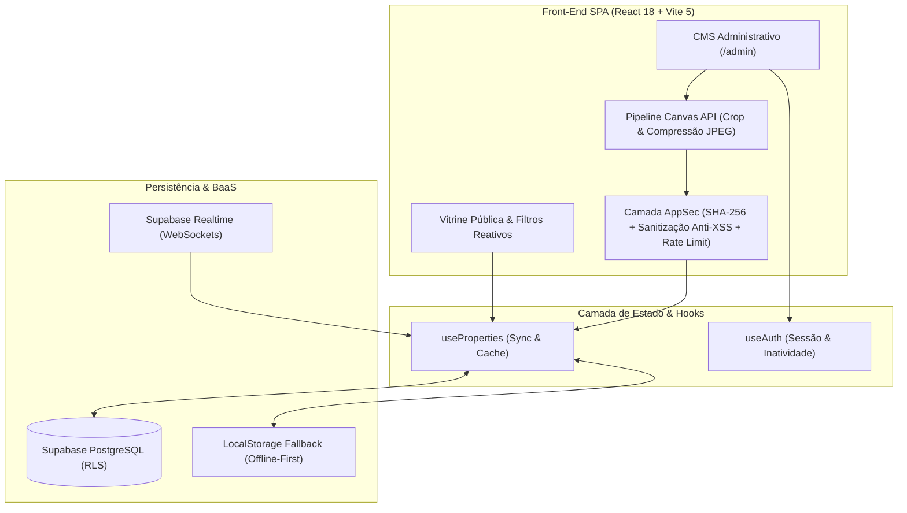

# Real Estate Platform & Realtime CMS — Case Study Full-Stack


Aplicação web completa (**Vitrine Imobiliária + CMS Administrativo em Tempo Real**) projetada, arquitetada e desenvolvida do zero por **[Vitor (@vitto2099)](https://github.com/vitto2099)** para um cliente real do setor imobiliário (*Anderson Kunicki — Corretor de Imóveis, CRECI-SC 60173 F*).

Mais do que um site institucional, este projeto foi construído como uma **solução de engenharia em produção**, resolvendo desafios reais de sincronização em tempo real via WebSockets, compressão e recorte de imagens *client-side* via Canvas API, segurança defensiva (AppSec) e SEO técnico com *deep-linking*.

---

## O Desafio de Engenharia & Solução

No fluxo tradicional de corretores independentes, o cadastro de imóveis pelo celular costuma ser lento, fotos tiradas diretamente da câmera pesam entre 5 MB e 12 MB cada, e o compartilhamento no WhatsApp perde o contexto de qual imóvel o cliente está visualizando.

Para resolver isso de ponta a ponta sem custos elevados de infraestrutura para o cliente, projetei uma arquitetura enxuta e resiliente:

1. **Arquitetura Híbrida (Cloud Realtime + Offline-First Fallback):**
   - Integração com **Supabase (PostgreSQL + Realtime WebSockets)** no hook customizado [`useProperties.js`](src/hooks/useProperties.js), permitindo que qualquer alteração feita no painel administrativo reflita instantaneamente na tela dos visitantes conectados.
   - Caso as variáveis de nuvem não estejam configuradas ou haja queda de rede, o sistema opera de forma transparente em modo *LocalStorage Fallback*, garantindo disponibilidade contínua e facilitando o ambiente de desenvolvimento.

2. **Pipeline de Processamento de Imagem no Navegador (HTML5 Canvas API):**
   - Construção de um modal de recorte interativo ([`ImageCropModal.jsx`](src/components/admin/ImageCropModal.jsx)) e um compressor automático em [`PropertyFormModal.jsx`](src/components/admin/PropertyFormModal.jsx) utilizando `<canvas>` nativo.
   - Fotos enviadas pelo celular são redimensionadas e comprimidas em JPEG otimizado diretamente no *client-side* antes da persistência, reduzindo o payload em até **85%** sem depender de bibliotecas externas pesadas.

3. **Engenharia de Conversão & Deep-Linking Sem Backend SSR:**
   - Implementação de roteamento sincronizado via `History API` e *query params* (`/?imovel=CA-101`).
   - Ao clicar em qualquer botão de contato ou mensagem rápida no [`PropertyModal.jsx`](src/components/property/PropertyModal.jsx) ou no [`WhatsAppWidget.jsx`](src/components/layout/WhatsAppWidget.jsx), o sistema injeta automaticamente o código de referência, preço e o link direto do imóvel na mensagem do WhatsApp.

---

## Arquitetura do Sistema



---

## Destaques Técnicos (Por Dentro do Código)

### 1. Segurança Defensiva (AppSec) — [`src/utils/security.js`](src/utils/security.js)
- **Criptografia Nativa (Web Crypto API):** Senhas administrativas nunca trafegam ou são comparadas em texto puro; o sistema utiliza `crypto.subtle.digest('SHA-256')` para geração determinística de hashes de 64 caracteres hexadecimais.
- **Proteção Contra Brute-Force:** Implementação da função `validateLoginRateLimit`, que monitora tentativas falhas consecutivas e aplica bloqueio temporário (*lockout* de 60 segundos) na 5ª tentativa incorreta, além de encerramento automático de sessão por inatividade em [`useAuth.js`](src/hooks/useAuth.js).
- **Sanitização Anti-XSS e Whitelist de Protocolos:** Todo payload de imóvel passa por `sanitizePropertyPayload` e `sanitizeText`, removendo tags `<script>`, `<iframe>`, atributos de eventos inline (`onerror=`, `onload=`) e bloqueando URLs maliciosas (`javascript:`, `vbscript:`, `data:text/html`).
- **Blindagem de Embeds de Vídeo:** [`src/utils/video.js`](src/utils/video.js) valida estritamente o domínio e o formato do ID antes de gerar URLs de embed para YouTube e Vimeo.
- **HTTP Security Headers:** Configurados em [`vercel.json`](vercel.json) e [`public/.htaccess`](public/.htaccess) (`X-Content-Type-Options: nosniff`, `X-Frame-Options: DENY`, `Referrer-Policy: strict-origin-when-cross-origin`, `Permissions-Policy`).

### 2. Performance, Bundle Splitting & Mobile UX
- **Code Splitting Manual ([`vite.config.js`](vite.config.js)):** Separação estratégica dos *chunks* de build em `vendor` (React/ReactDOM), `supabase` (`@supabase/supabase-js`) e `icons` (`lucide-react`), otimizando o cache de longo prazo no navegador.
- **Gestos Touch Nativos & Ambient Blur:** Galeria de imagens com suporte a *swipe touch* horizontal (`onTouchStart` / `onTouchMove` / `onTouchEnd`), navegação por teclado (`ArrowLeft`, `ArrowRight`, `Escape`) e *ambient backdrop blur* para preencher proporções variadas sem faixas pretas bruscas.
- **Zero Dependências de UI Pesadas:** Todo o Design System foi construído em CSS moderno com variáveis semânticas em [`src/index.css`](src/index.css), mantendo o bundle CSS final em apenas **~2.5 KB (gzip)**.

### 3. Suíte de Testes Automatizados (Node.js Test Runner)
O projeto conta com **29 testes automatizados** distribuídos em 15 suítes utilizando o runner nativo `node:test` (zero dependências externas de teste):
- **[`tests/security.test.mjs`](tests/security.test.mjs):** Testa determinismo criptográfico SHA-256, neutralização de vetores XSS, validação de URLs seguras, higienização de payloads corrompidos, máquina de estados do *rate-limiting*, blindagem de vídeos, configuração do Supabase e varredura estática contra vazamento de chaves privadas (`service_role`, `PRIVATE KEY`, etc.) no código-fonte.
- **[`tests/usability.test.mjs`](tests/usability.test.mjs):** Audita regras de negócio imobiliárias, formatadores monetários/métricos (`Intl.NumberFormat`), geração de códigos por categoria (`CA-`, `TE-`, `SI-`, `AP-`, `CO-`, `AL-`), integridade dos tokens CSS e limites de complexidade dos componentes.

---

## Estrutura do Projeto

```text
siteTio/
├── public/                           # Ativos estáticos, logos oficiais, SEO (sitemap/robots)
├── src/
│   ├── components/
│   │   ├── admin/                    # CMS Administrativo (Dashboard, Login, Form, Crop Modal)
│   │   ├── common/                   # Componentes atômicos reutilizáveis (Toast, Ícones)
│   │   ├── layout/                   # Estrutura global (Header, Footer, WhatsAppWidget)
│   │   ├── property/                 # Domínio de imóveis (Card, Filters, Modal, FullscreenGallery)
│   │   └── sections/                 # Seções institucionais (Hero, AboutContact, PrivacyPage)
│   ├── config/                       # Configurações centralizadas do ambiente e cliente
│   ├── data/                         # Dados iniciais de fallback e regras de prefixos
│   ├── hooks/                        # Custom Hooks (useAuth, useProperties, useToast)
│   ├── lib/                          # Cliente Supabase e verificação de ambiente
│   ├── utils/                        # Utilitários puros (security, formatters, video)
│   ├── App.jsx                       # Orquestrador de rotas SPA, deep-linking e estados globais
│   ├── index.css                     # Design System, variáveis CSS e responsividade
│   └── main.jsx                      # Ponto de entrada React 18
├── tests/
│   ├── security.test.mjs             # Suíte de testes de segurança e AppSec
│   └── usability.test.mjs            # Suíte de testes de regras de negócio, UI e UX
├── vercel.json                       # Regras de rewrite SPA e headers HTTP de segurança
├── vite.config.js                    # Configuração de build e code-splitting manual
└── package.json                      # Scripts e dependências do projeto
```

---

## Como Executar e Testar Localmente

### Pré-requisitos
- **Node.js** `>= 18.x` (recomendado `20 LTS` ou `22 LTS`)

### 1. Clonar e instalar dependências
```bash
git clone https://github.com/vitto2099/siteTio.git
cd siteTio
npm install
```

### 2. Variáveis de Ambiente (Opcional para rodar localmente)
O projeto funciona imediatamente sem configuração extra graças ao *fallback* local. Para conectar ao banco em tempo real no **Supabase**, copie o arquivo de exemplo:
```bash
cp .env.example .env.local
```
E preencha `VITE_SUPABASE_URL` e `VITE_SUPABASE_ANON_KEY`.

### 3. Executar a suíte de testes automatizados
```bash
npm test
```

### 4. Iniciar o servidor de desenvolvimento
```bash
npm run dev
```
O servidor iniciará em `http://localhost:3000`.
- **Vitrine Pública:** `http://localhost:3000/`
- **Sobre e Contato:** `http://localhost:3000/sobre`
- **Painel CMS Administrativo:** `http://localhost:3000/admin`

### 5. Build de Produção
```bash
npm run build
npm run preview
```

---

## Autor & Engenharia

Desenvolvido por **Vitor** — Engenheiro de Software / Desenvolvedor Full-Stack.

- **GitHub:** [@vitto2099](https://github.com/vitto2099)
- **E-mail:** [vck987123@gmail.com](mailto:vck987123@gmail.com)
